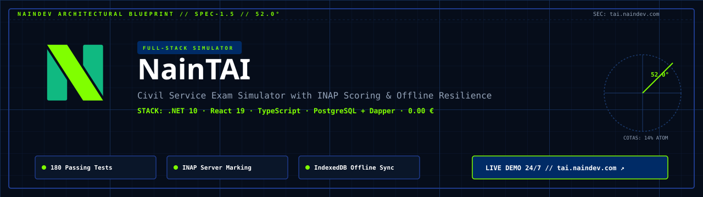
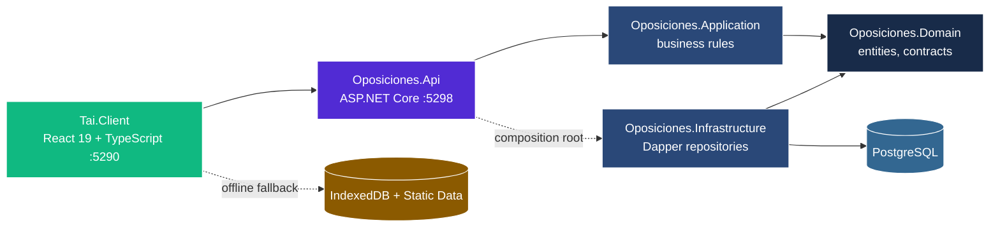

<picture>
  <source media="(prefers-color-scheme: dark)" srcset="docs/assets/banner-dark.svg">
  <source media="(prefers-color-scheme: light)" srcset="docs/assets/banner-light.svg">
  
</picture>

<div align="center">

[](https://tai.naindev.com/)
[](https://dotnet.microsoft.com/)
[](tests/Oposiciones.UnitTests/Architecture/ArchitectureTests.cs)
[](https://react.dev/)
[](https://www.typescriptlang.org/)
[](docs/21-data-model.md)
[](docs/50-traceability.md)
[](docs/20-architecture.md)

</div>

Full-stack civil service exam simulator platform aimed at the Spanish **TAI** examination (Técnico Auxiliar de Informática, INAP). It serves a question bank drawn from the official syllabus, marks attempts under the official scale, provides offline resilience via IndexedDB, and reports actionable performance analytics.

Consolidated monorepo delivering the complete product: PostgreSQL database migrations, .NET 10 Clean Architecture backend API, and React 19 SPA client.

---

## Features

- **Study & Exam Modes.** Immediate explanations with rationale in *Study mode*; timed countdown and hidden answers in *Exam mode*.
- **Official INAP Marking.** +1.00 per correct answer, −0.33 per wrong one, 0.00 for blanks. Server-authoritative scoring prevents client-side grade tampering.
- **Attempt Lifecycle.** Start, answer question by question, finish. Answers are validated against the attempt's own test with candidate session isolation.
- **Progress Analytics & Daily Goals.** Accuracy, average grade, per-block breakdown, 10-attempt rolling trends, daily practice goals, and study streaks.
- **Offline Resilience.** Exams sat without signal are queued in IndexedDB and replayed once connectivity returns. A reload mid-exam preserves the answer sheet and timer.
- **Secure Cookie Sessions.** JWT never touches JavaScript; `HttpOnly` SameSite cookies plus a session-scoped CSRF token, rotation, and server revocation list.

---

## Architecture

Dependencies point inwards. Clean Architecture over four backend projects with a decoupled frontend client.



| Layer / Component | Location | Description |
| :--- | :--- | :--- |
| **Web Client** | `Tai.Client/` | React 19, TypeScript, Zustand, TanStack Query, IndexedDB (:5290) |
| **Transport / API** | `src/Oposiciones.Api/` | ASP.NET Core Web API, JWT cookies, CSRF, Swagger (:5298) |
| **Application** | `src/Oposiciones.Application/` | Business rules, attempt scoring, and question service |
| **Domain** | `src/Oposiciones.Domain/` | Entities, invariants, syllabus blocks, and repository contracts |
| **Infrastructure** | `src/Oposiciones.Infrastructure/` | Dapper repositories, PostgreSQL stored functions |
| **Database** | `db/*.sql` | 8 ordered PostgreSQL schema migrations and synthetic seeds |

---

## Port Allocation

Registered in `D:\Development\Tools\dev-ports.json`:

| Service | Port | Hostname / URL |
| :--- | :--- | :--- |
| **Tai.Client** (Vite Dev) | `5290` | `http://tai.localhost:5290` |
| **Tai.Client** (Preview) | `5291` | `http://tai.localhost:5291` |
| **Oposiciones.Api** (HTTP) | `5298` | `http://tai.localhost:5298` |
| **Oposiciones.Api** (HTTPS) | `5299` | `https://tai.localhost:5299` |
| **PostgreSQL** | `55432` / `5292` | `127.0.0.1:55432` (or `5292` local container) |

---

## Quick Start

### 1. Database Setup

```bash
docker run -d --name tai-db -e POSTGRES_PASSWORD=tai -e POSTGRES_USER=tai -e POSTGRES_DB=oposicionestai -p 55432:5432 postgres:16-alpine

# Apply all migrations in order:
for f in db/*.sql; do docker exec -i tai-db psql -U tai -d oposicionestai -v ON_ERROR_STOP=1 -q < "$f"; done
```

### 2. Backend API (.NET 10)

```bash
dotnet run --project src/Oposiciones.Api/Oposiciones.Api.csproj
```

Interactive Swagger documentation lives at `http://tai.localhost:5298/swagger`.

### 3. Frontend Web Client (Tai.Client)

```bash
cd Tai.Client
npm install
npm run dev
```

The web client opens on `http://tai.localhost:5290`.

---

## Verification

Full suite of **180 automated tests**:

```bash
# Backend unit tests (84 tests)
dotnet test tests/Oposiciones.UnitTests

# Frontend verification: typecheck, lint, unit tests, and build (96 tests)
npm --prefix Tai.Client run verify
```

---

## API Surface

| Method | Route | Auth | Purpose |
| :--- | :--- | :--- | :--- |
| `GET` | `/api/health`, `/api/health/db` | — | Liveness and readiness |
| `GET` | `/api/syllabus/blocks`, `/api/syllabus/topics` | — | Official syllabus |
| `GET` | `/api/preguntas` | — | Randomised questions |
| `GET` | `/api/preguntas/bloque/{bloque}` | — | Questions for one block |
| `GET` | `/api/preguntas/disponibilidad` | — | Question count matching criteria |
| `POST` | `/api/auth/register`, `/api/auth/login` | — | Account and session |
| `POST` | `/api/auth/refresh`, `/api/auth/logout` | cookie | Session rotation and teardown |
| `GET` | `/api/auth/me` | cookie | Current profile |
| `POST` | `/api/progreso` | cookie + CSRF | Record an attempt |
| `GET` | `/api/progreso/historial` | cookie | Paginated history |
| `GET` | `/api/progreso/estadisticas` | cookie | Performance dashboard |
| `DELETE` | `/api/progreso/historial` | cookie + CSRF | Clear own history |
| `GET` | `/api/tests/{id}` | — | Test detail without answer key |
| `POST` | `/api/tests/generate` | cookie + CSRF | Generate a test |
| `POST` | `/api/attempts/start`, `/{id}/answer`, `/{id}/finish` | cookie + CSRF | Attempt lifecycle |

---

## Documentation

This repository follows **Spec Driven Development**: every change starts in a document.
Start at [`docs/README.md`](docs/README.md).

- [Charter](docs/00-charter.md) — goal, scope, non-goals
- [Requirements](docs/10-requirements.md) — `REQ-###` in EARS notation
- [Open questions](docs/11-open-questions.md) — unresolved ambiguity, and what it blocks
- [Architecture](docs/20-architecture.md) · [Data model](docs/21-data-model.md)
- [Decisions](docs/30-decisions/) — 9 ADRs (including ADR-0009 monorepo consolidation)
- [Tasks](docs/40-tasks.md) · [Blockers](docs/41-blockers.md)
- [Traceability](docs/50-traceability.md) — requirements mapping to tests
- [Runbook](docs/60-runbook.md) · [Changelog](docs/90-changelog.md)
- [Deployment](DEPLOYMENT.md) — Neon, Render, and Vercel setup

---

## Author

Architecture and implementation by [NainDev (Aitor Nain)](https://github.com/Nain9Dev).
